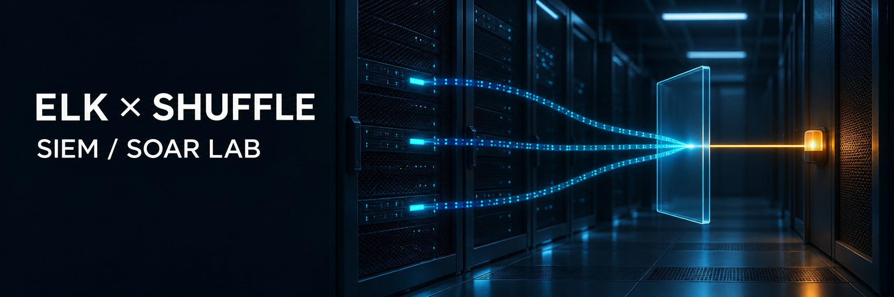

# ELK × Shuffle SIEM–SOAR Lab



Đồ án xây dựng và đánh giá hệ thống giám sát an ninh trên VMware và AWS EC2. ELK thu thập log Windows, Linux, web và pfSense, phát hiện hành vi theo MITRE ATT&CK rồi chuyển cảnh báo sang Shuffle. Playbook có thể gửi thông báo, thực hiện ứng phó hoặc chờ analyst phê duyệt. OPS3 tổng hợp kết quả theo từng đợt kiểm thử.

## Kết quả

| Phần | Trạng thái ghi nhận |
| --- | --- |
| Thu thập log | Tài liệu hạ tầng ghi nhận dữ liệu Windows, Ubuntu, Nginx và pfSense trong Elasticsearch. |
| PB01 | Có biên bản đầu cuối cho một ca đối chứng bằng lưu lượng thật và một ca dương tính bằng log giả lập. |
| PB02, PB03, PB05, PB15, PB18, PB23 | Tài liệu ngày 24–25/11/2026 ghi nhận đã triển khai. Ô minh chứng từng ca để trống. |
| PB16, PB31 | Có mã sinh rule và workflow. Ô kết quả triển khai để trống. |

Xem [kết quả và cách đo](docs/results.md) và [các mục còn trống](docs/pending.md).

## Kiến trúc hệ thống



| Lớp | Thành phần | Nhiệm vụ |
| --- | --- | --- |
| Mạng lab | VMware, pfSense, WireGuard | Kết nối máy lab với EC2 và chuyển log firewall, DNS |
| Thu thập | Sysmon, Winlogbeat, Filebeat, auditd, Nginx | Ghi và chuyển log nguồn |
| SIEM | Logstash, Elasticsearch, Kibana | Chuẩn hóa, lưu trữ và phát hiện |
| SOAR | Alert Forwarder, Shuffle, OpenSearch | Chuyển cảnh báo, điều phối workflow và lưu trạng thái Shuffle |
| Vận hành | Telegram, OPS3 | Thông báo, ghi hậu kiểm và tổng hợp chỉ số |

Chi tiết ở [kiến trúc](docs/architecture.md) và [luồng ứng phó](configs/shuffle/workflow.md).

## Kịch bản giám sát

Các trường hợp đã mô tả gồm quét cổng chu vi, hoạt động web bất thường, xác thực bất thường, tải file đáng nghi, tác vụ định kỳ và thay đổi nhật ký Windows. Bảng [kịch bản giám sát](docs/scenarios.md) gắn từng playbook với nguồn log và chế độ ứng phó. Bảng [MITRE ATT&CK](docs/mitre-attack-coverage.md) đối chiếu kỹ thuật và rule.

## Bắt đầu

Để kiểm tra phần tổng hợp OPS3 với dữ liệu mẫu có sẵn, chạy từ thư mục gốc của repo bằng Python 3.

```bash
python -B scripts/metrics/test_ops3_metrics.py
```

Xem [hướng dẫn cấu hình](docs/setup.md) để kiểm tra đường thu log, cấu hình forwarder và chuẩn bị Shuffle. Các mẫu cấu hình dùng hai mạng Docker `elk` và `shuffle`. Kibana và giao diện Shuffle mặc định chỉ bind vào loopback.

## Cấu trúc repo

```text
docs/           Kiến trúc, cấu hình, kịch bản, kết quả và nguồn Mermaid
configs/        ELK, rule Elastic, Beats và Shuffle
scripts/        Forwarder, rule generator, OPS3 và trình xử lý phòng thủ
screenshots/    Ảnh bìa, sơ đồ và thư mục dành cho ảnh nghiệm thu
```
