# Luồng ứng phó trong Shuffle

1. Nhận webhook từ forwarder. Kiểm tra đầu vào, trùng lặp và allowlist trước khi xem xét phản ứng.
2. Làm giàu thông tin với cảnh báo và sự kiện liên quan. Kiểm tra cooldown theo thực thể.
3. Phân nhánh thông báo, ứng phó tự động hoặc chờ phê duyệt tùy playbook và rule.
4. Hậu kiểm trạng thái trên thiết bị khi có hành động. Gửi thông báo và ghi kết quả để OPS3 tổng hợp.

PB01 là luồng thông báo với một bước ghi bằng chứng sau Telegram theo biên bản ngày 24/11. Nhánh dừng sớm trong PB01 có phạm vi ghi kết quả riêng.

PB31 dùng chung một nút User Input cho cả Ubuntu và Windows. Sau khi được duyệt, workflow chọn nhánh theo hệ điều hành và ghi kết quả kèm ID của bước duyệt. PB16 chạy tự động và đối chiếu việc chặn kết nối ra qua log pfSense. [Minh chứng PB16 và PB31](../../docs/evidence/pb16-pb31/2026-11-25.md).

## Tệp cấu hình

- [Compose override](docker-compose.override.yml) bổ sung cho Compose gốc của Shuffle theo phiên bản trong mẫu môi trường.
- [Mẫu biến môi trường](.env.example) giữ trống ID cài đặt và khóa vận hành.
- [Mã dựng workflow](../../scripts/soar/build-workflows.py) cần workflow PB01 làm mẫu metadata, kết nối Shuffle và tài khoản riêng của môi trường lab.
- [Thư mục export](exports/) dành cho bản JSON đã được rà soát thông tin xác thực.
