# Kiến trúc ELK–Shuffle

## Mạng và thành phần

| Khu vực | Thành phần | Vai trò |
| --- | --- | --- |
| VMware Lab | pfSense | Gateway giữa LAN và WAN của lab, nguồn log firewall và DNS |
| VMware Lab | Ubuntu | Nginx, auditd và Filebeat. Filebeat có cấu hình nguồn log xác thực web tùy lúc dịch vụ phát sinh dữ liệu |
| VMware Lab | Windows | Event Log và Sysmon do Winlogbeat chuyển tiếp |
| AWS EC2 | WireGuard và Docker | Điểm nhận luồng log qua VPN, chạy hai mạng Docker `elk` và `shuffle` |
| AWS EC2 | Elasticsearch và Kibana | Chỉ mục log, Elastic Security và tra cứu điều tra |
| AWS EC2 | Shuffle và OpenSearch | Workflow và kho dữ liệu của Shuffle |
| Tích hợp | Alert Forwarder và Telegram | Cầu nối chỉ mục cảnh báo với webhook, kênh thông báo |

Cấu hình mẫu giữ địa chỉ mạng riêng của lab làm ví dụ. Khi đổi subnet, đối chiếu địa chỉ listener trong Compose, SAN chứng chỉ, địa chỉ đích trong Beats và tuyến WireGuard.

## Luồng log đến cảnh báo

1. Windows và Ubuntu gửi Beats qua TLS tới Logstash cổng TCP 5044. pfSense gửi syslog qua VPN tới UDP 5514.
2. Logstash chuẩn hóa các trường cần dùng để tra cứu và định tuyến dữ liệu vào chỉ mục `datn-*`.
3. Elastic Security chạy các rule phát hiện. Alert Forwarder đọc chỉ mục cảnh báo bằng API key và định tuyến sang webhook tương ứng với playbook.
4. Shuffle làm giàu cảnh báo, gửi thông báo hoặc điều phối phản ứng trong lab. OPS3 đối chiếu các lượt thử với cảnh báo và kết quả hậu kiểm.

Nguồn sơ đồ có thể chỉnh sửa trong [docs/diagrams](diagrams/).
